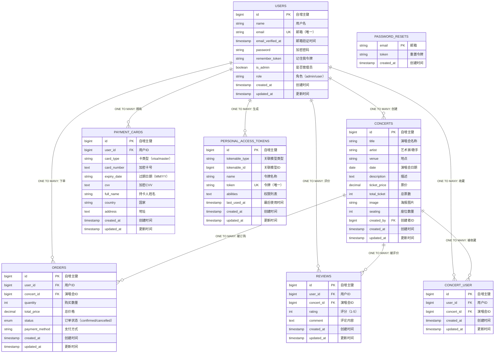

# Concert System - 完整数据库ERD与关系图

## Mermaid ERD 完整代码



## 关系说明表

### 一对多（ONE TO MANY）关系

| 关系ID | 主表 | 从表 | 外键字段 | 关系类型 | 说明 |
|--------|------|------|---------|---------|------|
| 1 | USERS | CONCERTS | created_by | **1:N** | 一个用户可以创建多个演唱会 |
| 2 | USERS | ORDERS | user_id | **1:N** | 一个用户可以下多个订单 |
| 3 | USERS | REVIEWS | user_id | **1:N** | 一个用户可以写多个评论 |
| 4 | USERS | CONCERT_USER | user_id | **1:N** | 一个用户可以收藏多个演唱会 |
| 5 | USERS | PAYMENT_CARDS | user_id | **1:N** | 一个用户可以保存多张支付卡 |
| 6 | USERS | PERSONAL_ACCESS_TOKENS | tokenable_id | **1:N** | 一个用户可以生成多个API令牌 |
| 7 | CONCERTS | ORDERS | concert_id | **1:N** | 一个演唱会可以被多个用户订购 |
| 8 | CONCERTS | REVIEWS | concert_id | **1:N** | 一个演唱会可以收到多个评论 |
| 9 | CONCERTS | CONCERT_USER | concert_id | **1:N** | 一个演唱会可以被多个用户收藏 |

### 多对多（MANY TO MANY）关系

| 关系 | 主表 | 从表 | 联接表 | 说明 |
|------|------|------|--------|------|
| **M:N** | USERS | CONCERTS | CONCERT_USER | 用户-演唱会收藏 |

**CONCERT_USER 约束：**
- `UNIQUE KEY (user_id, concert_id)` - 确保用户只能收藏同一演唱会一次
- 删除级联：用户或演唱会删除时，对应收藏记录自动删除

### 特殊关系

| 表 | 特殊说明 |
|----|---------|
| **REVIEWS** | `UNIQUE KEY (user_id, concert_id)` - 用户对同一演唱会只能评价一次 |
| **PAYMENT_CARDS** | 存储加密的支付卡信息，用户可以保存多张卡 |
| **PASSWORD_RESETS** | 临时表，用于密码重置流程 |
| **PERSONAL_ACCESS_TOKENS** | Sanctum授权表，用于API认证 |

## 数据库索引

### 主键与唯一键
```sql
-- 主键 (PRIMARY KEY)
USERS.id, CONCERTS.id, ORDERS.id, REVIEWS.id, 
CONCERT_USER.id, PAYMENT_CARDS.id, PERSONAL_ACCESS_TOKENS.id

-- 唯一键 (UNIQUE)
USERS.email
REVIEWS.user_id + concert_id
CONCERT_USER.user_id + concert_id
PERSONAL_ACCESS_TOKENS.token
PASSWORD_RESETS.email
```

### 外键索引 (FOREIGN KEY)
```sql
CONCERTS.created_by → USERS.id
ORDERS.user_id → USERS.id
ORDERS.concert_id → CONCERTS.id
REVIEWS.user_id → USERS.id
REVIEWS.concert_id → CONCERTS.id
CONCERT_USER.user_id → USERS.id
CONCERT_USER.concert_id → CONCERTS.id
PAYMENT_CARDS.user_id → USERS.id
PERSONAL_ACCESS_TOKENS.tokenable_id → USERS.id
```

### 查询索引
```sql
-- 性能优化的普通索引
USERS: idx_email, idx_is_admin, idx_role
CONCERTS: idx_artist, idx_venue, idx_date, idx_created_by
ORDERS: idx_user_id, idx_concert_id, idx_status, idx_created_at
REVIEWS: idx_user_id, idx_concert_id, idx_rating
CONCERT_USER: idx_user_id, idx_concert_id
PAYMENT_CARDS: idx_user_id, idx_card_type
PERSONAL_ACCESS_TOKENS: idx_tokenable_type_id, idx_token
```

## 级联删除规则

所有外键都配置了 `ON DELETE CASCADE`，含义：
- 删除用户 → 自动删除该用户的所有订单、评论、收藏、支付卡和令牌
- 删除演唱会 → 自动删除该演唱会的所有订单、评论和收藏

## 数据流向示例

### 用户购票流程
```
1. 用户登录 (USERS 表)
2. 浏览演唱会 (CONCERTS 表)
3. 创建订单 (ORDERS 表) - 关联 user_id 和 concert_id
4. 选择支付卡 (PAYMENT_CARDS 表)
5. 订单状态更新为 'confirmed'
```

### 用户评价流程
```
1. 用户登录 (USERS 表)
2. 查看已购票的演唱会 (通过 ORDERS 表)
3. 撰写评论 (REVIEWS 表) - 关联 user_id 和 concert_id
4. 同时更新演唱会评分统计
```

### 用户收藏流程
```
1. 用户登录 (USERS 表)
2. 浏览演唱会 (CONCERTS 表)
3. 收藏演唱会 (CONCERT_USER 表) - 插入 user_id 和 concert_id
4. 已收藏演唱会在用户个人页面展示
```
